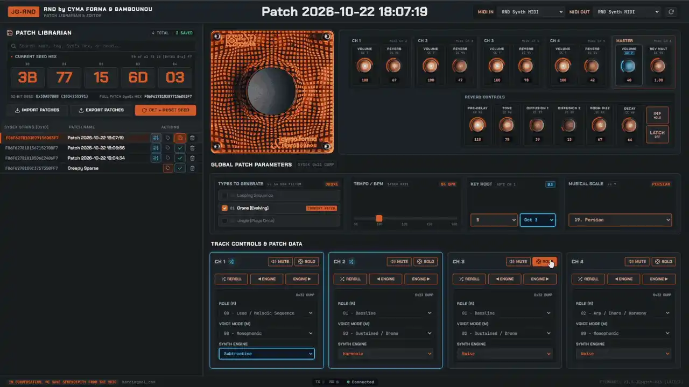

# JG-RND - Web-Based Librarian and Patch Editor For Cyma Forma RND With Custom Firmware Patch

**[YOUTUBE TUTORIAL AND OVERVIEW](https://youtu.be/XlZPPMOjZqM)**

A single-page web-MIDI editor for Cyma Forma & Bambounou RND with custom firmware, it builds in a layer of conversation with the RND allowing you to tweak, store and reload randomised patches.

Plug in the RND and the web interface should detect and select it, once you give it permissions. 

Future versions are planned to include an entirely separate mode of my own, and other features.

Firmware flashing on the RND is very safe. Its particular hardware setup means the bootloader is built into the chip ROM. As a result even a failed flash can be recovered. This editor's interface does not allow you to overwrite any bytes that would brick the device. The flashing tool is based on the same WebDFU tool used on the official Cyma Forma site.

## DISCLAIMER

**Use at your own risk.** This editor and the JGpatch firmware are an unofficial, independent hobbyist project. They are not made, endorsed, or supported by Cyma Forma or Bambounou, and I have no affiliation with them.

* The software and firmware are provided "as is", without warranty of any kind, as set out in the [LICENSE](LICENSE).
* Flashing modified firmware is done entirely at your own choice and risk. I accept no responsibility or liability for any damage, data loss, malfunction, voided warranty, or other consequences arising from using this software or firmware on your device.
* There is no official support for this project, from me or from Cyma Forma. Please do not contact Cyma Forma for help with the editor or the patched firmware. I'm happy to hear bug reports, but I can't promise fixes or help.
* You can return to official firmware at any time using Cyma Forma's own update page.

## FIRMWARE PATCH AND EDITOR FEATURES:

* 6 - Channel audio (Stereo mix on 1 and 2, raw instruments on 3-6)
* Limit type of patch that is generated- select any combination of Loop, Drone or Jingle (one shot), this will persist when the device is unplugged. Useful for disabling the one-shot generations.
* Reverb controls including momentary and latched infinite feedback and more.
* Master reverb multiplier control .
* Master-bus audio limiter in firmware to prevent reverb freeze hard clipping.
* Trigger patch generation from the interface.
* Manually enter seed hex in the interface.
* Store edited parameters to the library and recall them.
* Grab the current seed from the device, or reset changes made in the interface.
* Export and Import patch libraries as CSV, which can be manually edited easily.
* Reorder library patches with drag and drop.
* Add patch tags that are searchable.
* Edit store and recall BPM.
* Edit store and recall Key Root and Scale.
* Edit store and recall exact randomised re-rolls of Synth Engine sound.
* Edit store and recall altered synth engines (within the limits chosen by Cyma Forma).

## ROADMAP
* Compatibility with iOS and iPadOS.
* Feature parity with future official firmware updates.
* My own different mode of use which is part designed and will be very different but also generative and enjoyable.
* Tell me what you want.

## BUGS
* Please report them to me so I can fix them!

---

# USING THE EDITOR

## PATCHING THE FIRMWARE

To use all the features of the editor you must patch the firmware. I've made this really easy. If you plug in the RND without patched firmware, a notice will pop up linking a download for the stock firmware. Download this, and follow the instructions to patch the RND.

If it doesn't open automatically, click the Orange surround of the RND in the interface and follow the instructions.

If in future I have permission to host altered versions of Cyma Forma's original firmware I'll host them here and make this even simpler.

The patcher uses the same webdfu interface as the official Cyma Forma firmware update page. Follow the instructions and the latest JGpatch will be applied.

The patched firmware leaves RND acting like normal 1.3 firmware when it's not plugged into the edito and you're just hitting a button.

When the RND is plugged into the editor, the patched firmware allows access to far more controls than standard 1.3 and addresses a few issues with using it in this way.

None of the firmware patches removed "bugs" per say, because the RND was not intended to be used in this way as of 1.3.

They are more like extensions to normal function to allow the editor greater access to playing the RND as a conversation, rather than a one-way street.

Once you're on a JG firmware, if you load the editor and your JG firmware is out of date, it should prompt you to install the latest one. If not, just click the orange RND surround to open the patcher.

You can easily flash back to the official firmare at any time on the Cymaa Forma site.

## IF YOU DO NOT PATCH THE FIRMWARE, AND USE VANILLA 1.3:

* The Reverb Controls will not work.
* Changing any volume or reverb control will lock the rest of the session to using these levels for new or reloaded patches, until you cycle the power on the RND. 
* Changing the key root or scale, or sending any note or cc9 over MIDI channel 1, will lock all new patches and loaded patches to these keys for the rest of session until power is cycled. 
	* Additionally, a flag will be set that means any reloaded patch will sound different to it's original generation.
* BPM cannot be controlled or stored.
* Engine selection controls will not work as they rely on custom SysEx, not the standard SysEx.
* Possibly other quirks and strangeness which you may actually enjoy, who knows...

## PATCH LIBRARIAN
The left panel is a librarian. You can save, rename, export and import patches here. Export and Import uses an extremely lightweight CSV file, which can be manually edited in Excel or similar programmes if you like. You can reorder patches with drag and drop.

If you hit the button on the real RND or the interface RND, the new patch is dumped into the library. If you like it you can name it and save it. If not you can delete it. If you change any controls and save them, they will be reloaded when you reload the patch too. This way you can generate random ideas and tweak them a little, then bring them back later.

You can press Get + Reset Seed to return the patch to its generates state, as long as its loaded into the RND.

The big orange numbers are the part of the SysEx string that generates the random seed, so you can type random pairs of figures in here (1-9 and A-F, hexidecmial) to make patches in a different fun way.

## PATCH EDITOR
I've yet to write up these instructions in text form and don't want to use AI for it, but there's a video tutorial here: [YOUTUBE TUTORIAL AND OVERVIEW](https://youtu.be/XlZPPMOjZqM)

